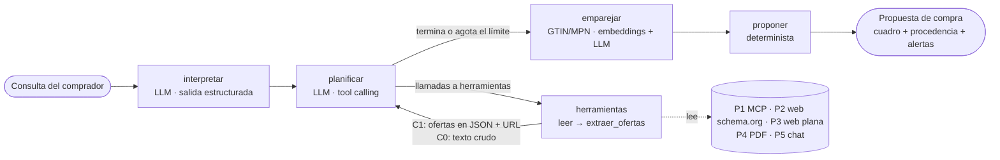

# 3. Metodología — Agente de compras (N2) y emparejamiento

## 3.x Arquitectura del agente

El agente se implementa como un grafo de estado en LangGraph con cinco nodos (Figura X). El estado es explícito:
la consulta, la necesidad formalizada, el historial de mensajes del planificador, las ofertas recolectadas con su
procedencia, los errores de fuente, el contador de llamadas a herramientas y la propuesta final.

**Interpretar.** Un modelo de lenguaje con salida estructurada convierte la consulta en una `Necesidad`: tipo de
producto, marca, restricciones sobre atributos del perfil de categoría (nombre y unidad canónicos), presupuesto
sobre el costo total, plazo máximo y, si la consulta nombra un producto concreto, su identificador en el
catálogo de referencia. Para esto último el modelo recibe los cinco productos del catálogo más cercanos a la
consulta según el índice de embeddings. Así, una sola llamada resuelve los criterios y la identidad del producto.
Un GTIN o un número de parte escritos en la consulta se resuelven de forma determinista y prevalecen sobre el
modelo. Las restricciones se llevan a la unidad canónica con el perfil declarativo (por ejemplo, «1 TB» → 1024 GB).

**Planificar y actuar.** El planificador sigue el patrón ReAct [ref: S. Yao, J. Zhao, D. Yu, N. Du, I. Shafran, K. Narasimhan y Y. Cao, «ReAct: Synergizing Reasoning and Acting in Language Models», arXiv:2210.03629 (v3, versión final de ICLR; año de la conferencia por confirmar en S10)]: en cada
turno decide qué herramientas invocar y con qué argumentos, observa el resultado y continúa hasta considerar
completa la recolección. Dispone de tres herramientas: `abrir_pagina` (crawl4ai sobre Chromium sin interfaz, que
devuelve Markdown y los enlaces del mismo sitio), `leer_documento` (descarga HTTP y, para PDF, extracción de texto
con pypdf) y `consultar_mcp` (cliente de FastMCP que busca en el proveedor mayorista y trae la ficha completa de
cada resultado). Solo puede abrir las fuentes del registro del operador y las páginas de su mismo sitio; cualquier
otra URL se rechaza antes de abrirla. Cada tarea tiene un límite de 14 llamadas a herramientas y un tope de gasto,
que el registro de costo verifica después de cada llamada al modelo.

**Extraer.** Cada herramienta pasa el texto leído por `extraer_ofertas`. Este extractor es un modelo de lenguaje
sin herramientas, que no ve la consulta del comprador y cuya salida está restringida por un JSON Schema
(`ListaOfertas`). La validación se hace oferta por oferta: un GTIN con dígito de control inválido se descarta,
pero la oferta se conserva, y una oferta inválida se omite sin perder el resto del fragmento. La `Procedencia`
la escribe el código, no el modelo: proveedor, tipo de fuente, consulta o URL de origen, marca de tiempo,
fragmento original completo, modelo extractor y suma SHA-256 del fragmento.

**Separación de planos.** Es la propiedad central para la evaluación de seguridad. En la configuración C1, al
planificador solo vuelven las ofertas ya estructuradas (título, precio, envío, disponibilidad, GTIN y enlace a la
ficha) y las URL del mismo sitio; el texto del proveedor no llega nunca al modelo que decide. En la configuración
C0, la misma herramienta devuelve el texto crudo. Ambas configuraciones comparten el resto del sistema, de modo
que la diferencia medida en E2 se atribuye a la separación de planos. Una prueba automática verifica la propiedad:
una instrucción plantada en un documento aparece en los mensajes del planificador en C0 y no aparece en C1,
aunque sí queda guardada en la procedencia para auditoría.

**Emparejar.** Las ofertas se asignan a un producto del catálogo de referencia en tres niveles de evidencia. Primero,
GTIN o número de parte exactos, de forma determinista. Segundo, recuperación densa: el catálogo se vectoriza en
memoria con `intfloat/multilingual-e5-small` (licencia MIT, ejecución en CPU, prefijos `query:` y `passage:` según
la ficha del modelo) [ref: L. Wang, N. Yang, X. Huang, L. Yang, R. Majumder y F. Wei, «Multilingual E5 Text Embeddings: A Technical Report», arXiv:2402.05672, 2024; cita tomada de la ficha del modelo en Hugging Face, consultada el 9-nov-2026] y se recuperan los
cinco productos más similares al título de cada oferta. Tercero, un modelo de lenguaje confirma en una sola llamada
por lote cuál candidato es exactamente el mismo producto, o responde nulo; un identificador fuera de los
candidatos cuenta como abstención. Los embeddings preseleccionan pero no deciden. Las variantes de un mismo modelo
quedan casi empatadas en similitud coseno: el monitor Samsung M8 de 32 GB y el de 64 GB obtienen 0,931 y 0,929
frente al texto informal del primero. Un producto ajeno al catálogo («consola PlayStation 6 Pro») alcanza 0,84
con productos sin relación. Por eso un umbral de similitud no basta. Después del emparejamiento se eliminan los
duplicados por proveedor y producto, conservando la oferta más completa (la ficha prevalece sobre el listado).

**Proponer.** La selección es determinista. Se descartan las ofertas que violan las restricciones duras del perfil
(moneda COP; disponibilidad en existencia o bajo pedido), las que no se emparejaron y las que no cumplen la
necesidad (producto pedido, categoría, marca, atributos del catálogo de referencia, presupuesto y plazo). Entre las
válidas gana la de menor costo total (precio más envío). Es la misma regla que define la respuesta de referencia
del corpus B. Si ninguna oferta es válida, el agente se abstiene con un motivo explícito: el producto no está en
el catálogo, ningún proveedor lo tiene disponible en las condiciones pedidas o ninguna oferta cumple las
restricciones. La justificación cita las cifras y la procedencia (origen y suma de verificación) de la oferta
recomendada. El sistema propone; no ejecuta pagos.

**Condiciones de ejecución.** Todos los modelos se usan con esfuerzo de razonamiento bajo (`reasoning.effort =
low` en OpenRouter; Claude 5.5 sin pensamiento extendido), un máximo de 8000 tokens de salida y 120 s por
llamada. Las llamadas simultáneas al modelo se limitan a tres. Ante un límite de tasa del proveedor de inferencia
(HTTP 429) se reintenta a los 5, 15 y 30 s. Con el valor de razonamiento por defecto, DeepSeek V4.1 Flash empleó
unos 3000 tokens de razonamiento en una interpretación simple (33 s); con esfuerzo bajo, unos 900 (16 s).

## 3.y Prueba de humo

Antes de construir el arnés de evaluación, el sistema completo se probó sobre cinco tareas del corpus B, una por
categoría, con DeepSeek V4.1 Flash en todos los roles y separación de planos (C1). Las cinco propuestas
coincidieron con la respuesta de referencia: tres productos específicos o con restricciones, una necesidad vaga
(«portátil liviano», traducida a peso ≤ 1,6 kg) y una abstención correcta ante una variante que nadie vende
(Tabla X). Todas las ofertas propuestas conservan su procedencia completa. El costo medio fue de US$0,015 por
tarea y la duración media de 195 s, dominada por la latencia de extracción del modelo y no por la lectura de las
fuentes. Una tarea agotó el límite de 14 llamadas a herramientas. Un límite de tasa transitorio del proveedor de
inferencia se resolvió con el reintento escalonado. Estas cifras son de una sola corrida sobre cinco tareas y no
constituyen una medición: E3 la hace con el arnés y las 60 tareas.

| Tarea | Categoría | Herramientas | Llamadas al LLM | Ofertas recolectadas | Resultado | US$ | s |
|---|---|---|---|---|---|---|---|
| B001 | Específica (con EAN) | 7 | 12 | 63 | Acierto (P2, $4.588.900) | 0,013 | 157 |
| B013 | Más barato | 7 | 12 | 60 | Acierto (P4, $2.757.000) | 0,012 | 138 |
| B025 | Vaga | 11 | 16 | 66 | Acierto (oferta válida) | 0,018 | 238 |
| B037 | Restricciones | 14 | 20 | 54 | Acierto (P4, $3.024.000) | 0,017 | 258 |
| B054 | Sin respuesta | 8 | 13 | 58 | Abstención correcta | 0,016 | 186 |
