# 3.u Pipeline de datos

Las ofertas de los proveedores llegan en cinco formatos de madurez creciente (mensaje, PDF, página sin marcado,
página con schema.org y servidor MCP). Antes de llegar a la decisión, cada dato atraviesa un pipeline con las etapas
clásicas de la preparación de datos: ingesta, limpieza, validación, normalización, deduplicación, codificación,
detección de atípicos y trazabilidad. La Figura 3.u.1 lo resume y la Tabla 3.u.1 asocia cada etapa con su técnica
y su verificación.

```mermaid
flowchart LR
    F["Fuentes<br/>MCP · schema.org · web · PDF · mensaje"] --> I["Ingesta<br/>crawl4ai → Markdown<br/>pypdf → texto<br/>MCP → JSON"]
    I --> L["Limpieza<br/>saneamiento del Markdown<br/>recorte centrado en precios"]
    L --> S["Filtrado de seguridad<br/>C2 por ventanas"]
    S --> E["Extracción a esquema<br/>LLM con salida estructurada<br/>o parser schema.org"]
    E --> V["Validación<br/>Pydantic · GTIN · ISO 4217<br/>SHA-256 de procedencia"]
    V --> N["Normalización<br/>unidades y categorías<br/>canónicas del perfil"]
    N --> D["Deduplicación<br/>la ficha gana al listado"]
    D --> C["Codificación<br/>embeddings e5<br/>emparejamiento"]
    C --> A["Atípicos<br/>C3: banda del catálogo<br/>y mediana del mercado"]
    A --> X["Verificación<br/>N3, segunda ruta"]
    X --> R["Decisión determinista<br/>y propuesta con procedencia"]
```

**Figura 3.u.1.** Pipeline de datos de una oferta, de la fuente a la propuesta.

**Tabla 3.u.1.** Etapas del pipeline.

| Etapa | Qué hace | Técnica | Verificación |
| --- | --- | --- | --- |
| Ingesta | Convierte cada fuente en texto o datos | crawl4ai con Chromium para la web (Markdown), pypdf para los PDF, cliente MCP para el servidor del mayorista; el bloque schema.org se antepone al Markdown de cada ficha | Corpus congelados con huella SHA-256 por archivo; E1 regeneró los 110 fragmentos y todos reprodujeron su huella |
| Limpieza | Retira el ruido que no es contenido comercial | Saneamiento del Markdown de las fuentes abiertas: imágenes, URI `data:`, parámetros de URL y cadenas base64 largas; recorte centrado en las líneas con precio | Medición pareada en 81 páginas reales: ventanas marcadas por C2 de 19,8 % a 0,4 % y texto al extractor −15,2 % |
| Filtrado de seguridad | Retira las instrucciones incrustadas | C2: ventanas de hasta 1 200 caracteres puntuadas por un clasificador local de inyección; se retiran las marcadas y los enlaces que solo aparecían en ellas | 0 falsos positivos en los fragmentos limpios del corpus B; E2 |
| Extracción a esquema | Lleva el texto libre a un registro tipado | Salida estructurada con esquema JSON (`json_schema`) y extractor con LLM; parser determinista donde hay schema.org o JSON | M1, exactitud campo a campo frente a la verdad de referencia |
| Validación | Rechaza registros mal formados o imposibles | Esquemas Pydantic (precio > 0, envío ≥ 0, moneda ISO 4217, disponibilidad en un vocabulario cerrado), dígito de control del GTIN, procedencia obligatoria sellada con SHA-256 | Pruebas automatizadas del esquema; procedencia completa en el 100 % de las ejecuciones de E3 |
| Normalización | Hace comparables los atributos de proveedores distintos | Perfil de categoría con unidad canónica y factores de conversión por atributo numérico, y categorías canónicas con sus variantes de escritura | Pruebas del perfil |
| Deduplicación | Une la misma oferta leída en un listado y en una ficha | Antes del emparejamiento, por proveedor y título normalizado; después, por proveedor y producto del catálogo. En ambos pasos se conserva el registro más completo | Pruebas del agente |
| Codificación | Representa títulos y productos en un espacio vectorial | Embeddings densos con `multilingual-e5-small` (local, CPU) para preseleccionar candidatos del catálogo; el GTIN o el MPN exactos tienen prioridad y un LLM confirma la identidad | Calibración del emparejamiento |
| Detección de atípicos | Señala precios anómalos frente al mercado | C3: se excluye con una alerta el precio que cae fuera de una banda alrededor del precio de referencia del catálogo, o que es menor que 0,8 veces la mediana de los demás proveedores del mismo producto | E2 (carga de precio falso A20) |
| Verificación | Confirma los campos que deciden la compra | N3: segunda lectura por otra ruta y comparación de precio, envío, disponibilidad, plazo y GTIN | E1 y E1 con fallas sembradas |
| Trazabilidad | Permite auditar cada cifra | Procedencia por oferta (fuente, consulta, fecha, fragmento y SHA-256) persistida con la propuesta en PostgreSQL | Laboratorio de CotIA: ofertas finales con su procedencia |

La decisión final no forma parte del pipeline de datos: es una regla determinista (menor costo total entre las
ofertas que cumplen las restricciones) que solo consume registros que ya pasaron por todas las etapas.
