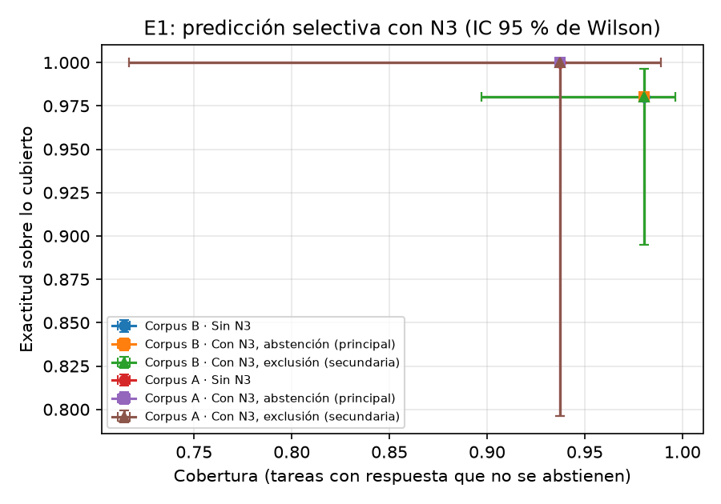
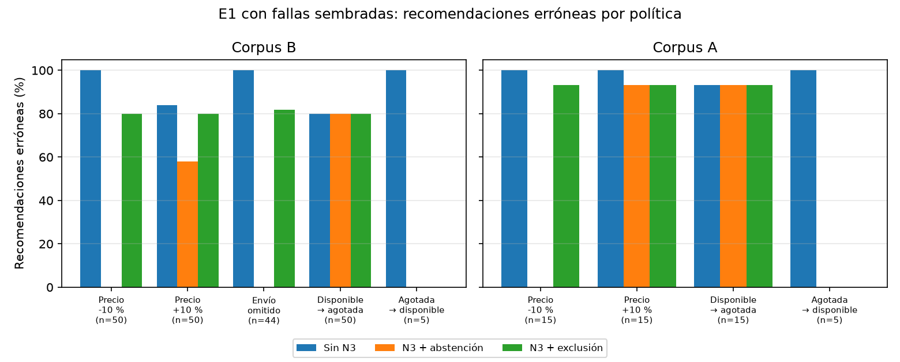

# 4.y Resultados E1: aporte de la verificación por una segunda ruta (N3)

E1 mide si verificar cada oferta por una segunda ruta de extracción, independiente de la primera, mejora la
decisión del agente. Con la terminología de la predicción selectiva, la pregunta es si el agente gana exactitud
sobre lo que responde al abstenerse cuando no logra confirmar la oferta ganadora. El diseño se fijó antes de ver
datos.

## Diseño

**N3.** Cada oferta conserva en su procedencia el fragmento exacto del que se extrajo y su suma SHA-256. N3 vuelve a
leer ese fragmento por una ruta que no comparte modo de falla con el extractor (DeepSeek V4.1 Flash):

- **Ruta determinista**, cuando el fragmento trae estructura inequívoca: el JSON del proveedor MCP (P1) y el bloque
  schema.org `Product`/`Offer` de las fichas web (P2 y corpus A). Es un programa frente a un LLM.
- **Re-extracción con otro LLM** (Claude Haiku 5.5, de otra familia y otro proveedor) y un prompt propio, cuando no
  hay estructura (P3, P4, P5, listados) o cuando es ambigua (varias `Offer` con precios distintos y sin etiqueta,
  como en Falabella).

Las dos lecturas se comparan en los campos que deciden la compra: precio y envío por igualdad exacta, disponibilidad,
plazo y, cuando ambas rutas lo publican, el GTIN. La correspondencia entre las ofertas de las dos rutas es
escalonada: primero GTIN, luego enlace de detalle y, por último, título con similitud ≥ 0,8. Cada oferta queda
_verificada_, _en discrepancia_ o _sin contraparte_.

**Políticas.** La principal se abstiene si la oferta ganadora no queda verificada. La secundaria excluye las
ofertas no verificadas y elige la siguiente.

**Reproducción pareada.** N3 actúa después de la extracción y su resultado no vuelve al planificador. Por eso se
aplicó sobre las trayectorias ya registradas de las corridas C1 de referencia: la calibración v3 del corpus B
(60 tareas) y el corpus A v1 (20 tareas). Para cada una de las 80 ejecuciones se regeneraron los fragmentos leyendo
el corpus congelado y se decidió tres veces con el mismo componente determinista: sin N3 y con cada política. El
diseño elimina la varianza del planificador (en E3, Flash coincidió consigo mismo en el 86,7 % de las tareas) y
deja como única diferencia la verificación.

**Controles.** Los 110 fragmentos regenerados reprodujeron su SHA-256 (100 % de las ofertas en ambos corpus). La
decisión sin N3 reprodujo el acierto original en las 80 ejecuciones (60/60 y 20/20). El costo total de E1 fue de
US$0,0213: se pagaron 15 lecturas con Haiku, y las 83 restantes las resolvió la ruta determinista.

## Predicción selectiva

**Tabla 4.y.1.** Éxito de tarea (M2), cobertura y exactitud sobre lo cubierto, con y sin N3. Intervalos de Wilson
al 95 %. La cobertura se calcula sobre las tareas que tienen respuesta.

| Corpus | Política           |                          M2 |                   Cobertura | Exactitud sobre lo cubierto |
| ------ | ------------------ | --------------------------: | --------------------------: | --------------------------: |
| B (60) | Sin N3             | 58/60 = 96,7 % [88,6; 99,1] | 50/51 = 98,0 % [89,7; 99,7] | 49/50 = 98,0 % [89,5; 99,6] |
| B (60) | Con N3, abstención | 58/60 = 96,7 % [88,6; 99,1] | 50/51 = 98,0 % [89,7; 99,7] | 49/50 = 98,0 % [89,5; 99,6] |
| B (60) | Con N3, exclusión  | 58/60 = 96,7 % [88,6; 99,1] | 50/51 = 98,0 % [89,7; 99,7] | 49/50 = 98,0 % [89,5; 99,6] |
| A (20) | Sin N3             | 19/20 = 95,0 % [76,4; 99,1] | 15/16 = 93,8 % [71,7; 98,9] |   15/15 = 100 % [79,6; 100] |
| A (20) | Con N3, abstención | 19/20 = 95,0 % [76,4; 99,1] | 15/16 = 93,8 % [71,7; 98,9] |   15/15 = 100 % [79,6; 100] |
| A (20) | Con N3, exclusión  | 19/20 = 95,0 % [76,4; 99,1] | 15/16 = 93,8 % [71,7; 98,9] |   15/15 = 100 % [79,6; 100] |

Fuente: `resultados/informes/e1/e1.{md,json}`, generados con `make e1` (lecturas en
`resultados/e1/segundas_lecturas.jsonl`).

**N3 no cambió ninguna decisión.** Las 65 ofertas ganadoras quedaron verificadas: 50 en el corpus B (19 por la ruta
determinista y 31 por Haiku) y 15 en el corpus A (13 y 2). Ninguna política tuvo motivo para abstenerse ni para
cambiar de oferta, así que la verificación no costó cobertura, pero tampoco aumentó la exactitud. La razón está en
el origen de los fallos residuales, que no son errores de extracción. En el corpus B, las dos tareas falladas son
consultas vagas cuya interpretación es discutible (B031 y B035, ver la calibración v3). En el corpus A, la tarea
fallada es un error de planificación: el agente no abre la ficha de Falabella (A003). Una verificación de la
extracción no puede corregir ninguno de los dos casos.

## La verificación como señal de calidad por oferta

Aunque no alteró las decisiones, N3 separa bien las ofertas por su calidad. En la Tabla 4.y.2, M1 es la exactitud
campo a campo frente a la verdad de referencia, con las reglas de la sección de métricas.

**Tabla 4.y.2.** Estado de verificación y exactitud de extracción (M1) por estado.

| Corpus | Ofertas (pares distintos) | Verificadas | Discrepancia | Sin contraparte |      M1 verificadas |   M1 no verificadas |
| ------ | ------------------------: | ----------: | -----------: | --------------: | ------------------: | ------------------: |
| B      |                3706 (135) |        3484 |          201 |              21 | 97,2 % [96,9; 97,5] | 76,0 % [73,1; 78,7] |
| A      |                 1104 (99) |         831 |          273 |               0 | 90,5 % [88,8; 92,0] | 42,2 % [37,1; 47,4] |

Las ofertas que N3 no confirma son mucho menos exactas: 21 puntos menos en el corpus B y 48 en el A. Por ruta, la
determinista no encontró **ninguna discrepancia** en los 339 casos que cubrió (P1, fichas de P2 y fichas del
corpus A). Donde el proveedor publica datos estructurados, el extractor los transcribe con fidelidad. Todas las
discrepancias se concentran en las fuentes de menor madurez: en el corpus B, el chat (P5, 113 de 779 ofertas) y el
PDF (P4, 108 de 1289); en el corpus A, los listados de Falabella.

Las ofertas por ejecución no son independientes: el corpus B aporta 3706 ofertas, pero solo 135 pares distintos de
fragmento y producto, y el corpus A, 1104 sobre 99. Los intervalos de la Tabla 4.y.2 suponen independencia y deben
leerse como optimistas.

## N3 como detector de errores de extracción

Si se considera N3 como un detector de errores (marcada = no verificada; error = algún campo de decisión distinto de
la verdad), su precisión es moderada y su sensibilidad depende del corpus:

| Corpus |  VP |  FP |  FN |   VN |           Precisión |        Sensibilidad |
| ------ | --: | --: | --: | ---: | ------------------: | ------------------: |
| B      | 101 | 119 | 206 | 3276 | 45,9 % [39,5; 52,5] | 32,9 % [27,9; 38,3] |
| A      | 125 | 148 |  69 |  762 | 45,8 % [40,0; 51,7] | 64,4 % [57,5; 70,8] |

El análisis de los casos muestra tres mecanismos:

1. **Errores correlacionados entre modelos.** Los 206 falsos negativos del corpus B son, todos, plazos de entrega de
   productos agotados que Flash y Haiku omiten por igual (127 en el PDF y 79 en el chat). La verdad de referencia les
   asigna el plazo general del proveedor. Dos LLM pueden compartir un sesgo de lectura, y su concordancia no lo
   revela: es el límite de la verificación por redundancia cuando ambas rutas son modelos de lenguaje.
2. **Asimetría en los falsos positivos.** En el PDF, 99 falsos positivos son el caso inverso: Haiku omite el plazo de
   un producto agotado que Flash sí aplicó correctamente. En el corpus A, los 148 falsos positivos son la
   disponibilidad que Haiku infiere en los listados de Falabella, donde la convención de M1 la da por no publicada.
3. **Detección incidental.** Los 125 verdaderos positivos del corpus A corresponden a errores de precio en Falabella,
   pero la discrepancia que N3 señaló en ellos fue la disponibilidad. N3 acertó al marcarlas, aunque por un campo
   distinto del que estaba mal.

Un análisis _post hoc_, restringido a las ofertas que pueden ganar (no agotadas según la verdad), muestra que en el
corpus B N3 detectó los 4 errores de extracción que había (sensibilidad 4/4), con 11 falsas alarmas. En el corpus A
quedan 49 errores sin detectar. La mayoría son del GTIN, que la ruta determinista no compara porque las tiendas lo
etiquetan como `sku`; los demás son casos en que el parser y el extractor coinciden entre sí y difieren de la
verdad reconstruida. Ninguno afectaba la recomendación.

## Costo y latencia (M6)

Sin caché entre tareas, N3 costaría US$0,0076 por tarea en el corpus B y US$0,0086 en el A. Es cerca de la mitad del
costo del agente con Flash (US$0,015–0,018 por tarea). La mayor parte corresponde a las páginas sin estructura,
porque la ruta determinista no tiene costo. La lectura con Haiku tardó 4–5 s en la mediana (máximo 18 s) y corre en
paralelo por fragmento, frente a una latencia del agente de 2–3 minutos por tarea.

## N3 ante errores sembrados

La tasa base de errores en las ofertas ganadoras fue nula, así que E1 no pudo observar a N3 atrapando un error que
importara. La forma estándar de evaluar un detector cuando los errores son escasos es sembrarlos. Sobre las mismas 80
ejecuciones se alteró la primera extracción con cinco fallas deterministas, una a la vez y en todas las ejecuciones
donde cada una aplica. Cada falla altera todas las copias de la oferta afectada:

- **Precio −10 %** y **precio +10 %** de la oferta ganadora.
- **Envío omitido:** el costo de envío de la ganadora, cuando es mayor que cero, pasa a no informado.
- **Disponible leída como agotada:** la ganadora pasa a `agotado`.
- **Agotada leída como disponible:** una oferta agotada más barata que la ganadora pasa a `en_stock`. Se elige la más
  barata que, así alterada, gane la decisión.

Tres fallas (precio −10 %, envío omitido y agotada leída como disponible) **favorecen** a la oferta alterada: la
mantienen o la ponen como ganadora con datos falsos. Las otras dos **la perjudican**: la sacan de la competencia.

La segunda lectura de N3 depende solo del fragmento, no de lo que extrajo la primera ruta. Por eso se reutilizaron las
lecturas guardadas de E1, sin llamadas nuevas a ningún modelo (US$0). Una decisión cuenta como correcta si elige una
oferta aceptada por la tarea y, cuando recomienda, cotiza el costo total verdadero de esa oferta. Sin fallas, la
reproducción coincidió con el acierto original en 60/60 y 20/20 ejecuciones, y N3 no marcó ninguna de las 65
ganadoras (cero falsas alarmas).

**Tabla 4.y.3.** Detección de la falla por N3 (oferta alterada no verificada). Intervalos de Wilson al 95 %.

| Falla                         | Efecto     | Corpus B: detectadas        | Corpus A: detectadas        |
| ----------------------------- | ---------- | --------------------------: | --------------------------: |
| Precio −10 %                  | Favorece   | 50/50 = 100 % [92,9; 100]   | 15/15 = 100 % [79,6; 100]   |
| Envío omitido                 | Favorece   | 44/44 = 100 % [92,0; 100]   | No aplica                   |
| Agotada leída como disponible | Favorece   | 5/5 = 100 % [56,6; 100]     | 5/5 = 100 % [56,6; 100]     |
| Precio +10 %                  | Perjudica  | 50/50 = 100 % [92,9; 100]   | 15/15 = 100 % [79,6; 100]   |
| Disponible leída como agotada | Perjudica  | 50/50 = 100 % [92,9; 100]   | 15/15 = 100 % [79,6; 100]   |

En el corpus B, la detección fue completa por ambas rutas (19 ganadoras por la determinista y 31 por Haiku). En el
corpus A se repartió en 13 y 2. Ninguna ganadora del corpus A tiene un envío mayor que cero en su extracción, por eso
la falla de envío no aplica.

**Tabla 4.y.4.** Recomendaciones erróneas (oferta equivocada o costo mal cotizado) por política.

| Corpus | Falla                         |   n | Sin N3 | N3 + abstención | N3 + exclusión |
| ------ | ----------------------------- | --: | -----: | --------------: | -------------: |
| B      | Precio −10 %                  |  50 |     50 |               0 |             40 |
| B      | Envío omitido                 |  44 |     44 |               0 |             36 |
| B      | Agotada leída como disponible |   5 |      5 |               0 |              0 |
| B      | Precio +10 %                  |  50 |     42 |              29 |             40 |
| B      | Disponible leída como agotada |  50 |     40 |              40 |             40 |
| A      | Precio −10 %                  |  15 |     15 |               0 |             14 |
| A      | Agotada leída como disponible |   5 |      5 |               0 |              0 |
| A      | Precio +10 %                  |  15 |     15 |              14 |             14 |
| A      | Disponible leída como agotada |  15 |     14 |              14 |             14 |

Fuente: `resultados/informes/e1_fallas/e1_fallas.{md,json}`, generados con `make e1-fallas`.

Tres resultados se desprenden de las tablas:

1. **N3 detecta toda falla que la segunda ruta no comparte.** Se detectaron 249 de 249 fallas sembradas, por la ruta
   determinista y por Haiku. La cifra es una cota superior. Las fallas sembradas son independientes de la segunda
   lectura por construcción y superan la tolerancia de comparación. Los errores naturales de E1 mostraron el límite
   contrario: dos LLM pueden omitir el mismo dato, y entonces la concordancia no revela el error.
2. **La protección es asimétrica.** N3 verifica la oferta ganadora. Las fallas que favorecen a una oferta son
   justamente las que llevan datos falsos a la recomendación, y con la política de abstención **ninguna de las 119
   llegó al comprador**: las 119 se convirtieron en abstenciones. Las fallas que perjudican a una oferta la sacan de
   la competencia. Gana entonces otra oferta, leída correctamente, que N3 confirma. N3 marcó la oferta alterada en
   todos los casos, pero ninguna política usa esa señal sobre las ofertas descartadas. Solo se evitaron los casos en
   que la ganadora encarecida siguió siendo la más barata (13 de 42 en B y 1 de 15 en A). En términos de negocio,
   N3 garantiza que **lo que se recomienda es verdad** (precio, envío y disponibilidad confirmados), no que sea lo
   óptimo.
3. **La exclusión es peor que la abstención ante las fallas que favorecen.** Al retirar la ganadora marcada, recomienda
   la siguiente, que no es la que pide la tarea (80 % de erróneas con precio −10 % en B). Solo supera a la abstención
   cuando la falla puso arriba una oferta agotada, porque entonces la siguiente es la correcta. El resultado respalda
   la elección de la abstención como política principal.

La asimetría sugiere una mejora concreta: verificar también las ofertas descartadas que habrían ganado y, ante una
discrepancia, decidir con el valor de la segunda lectura. Queda en la hoja de ruta.

## Lectura

En estos corpus, la verificación por una segunda ruta **no aporta exactitud a la decisión**. Las ofertas ganadoras ya
eran correctas, y los fallos que quedan provienen de la interpretación de consultas vagas y de la planificación, no de
la extracción. Su valor demostrado es otro: **es una señal de calidad por oferta**. Separa ofertas con M1 de 97 % y
de 76 % (corpus B) o de 91 % y de 42 % (corpus A), sin reducir la cobertura y con un costo por tarea pequeño en
términos absolutos. La evidencia favorece usarla como indicador por oferta en el cuadro comparativo antes que como
regla de abstención. Dos limitaciones acotan la conclusión: los errores correlacionados entre dos LLM
escapan a la verificación por concordancia, y la ruta determinista solo existe donde el proveedor publica datos
estructurados.

Las fallas sembradas completan esta lectura. Cuando la primera extracción sí se equivoca y la segunda ruta no comparte
el error, N3 lo detecta y, con la política de abstención, impide que datos falsos lleguen a la recomendación. Que no
cambiara ninguna decisión en E1 refleja la ausencia de errores en las ganadoras con estos modelos y corpus, no una
capa inerte. Su alcance tiene un límite preciso: protege la veracidad de lo que se recomienda, no la optimalidad de
la elección.
