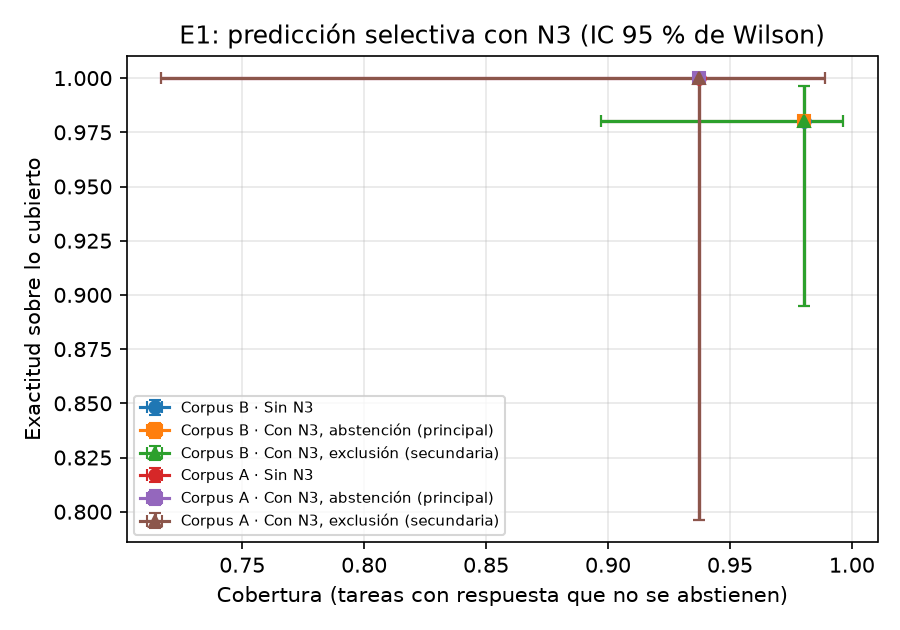

# 4.y Resultados E1: aporte de la verificación por una segunda ruta (N3)

E1 mide si verificar cada oferta por una segunda ruta de extracción, independiente de la primera, mejora la
decisión del agente. Con la terminología de la predicción selectiva, la pregunta es si el agente gana exactitud
sobre lo que responde al abstenerse cuando no logra confirmar la oferta ganadora. El diseño se fijó antes de ver
datos (D99–D104).

## Diseño

**N3.** Cada oferta conserva en su procedencia el fragmento exacto del que se extrajo y su suma SHA-256. N3 vuelve a
leer ese fragmento por una ruta que no comparte modo de falla con el extractor (DeepSeek V4.1 Flash):

- **Ruta determinista**, cuando el fragmento trae estructura inequívoca: el JSON del proveedor MCP (P1) y el bloque
  schema.org `Product`/`Offer` de las fichas web (P2 y corpus A). Es un programa frente a un LLM.
- **Re-extracción con otro LLM** (Claude Haiku 5.5, de otra familia y otro proveedor) y un prompt propio, cuando no
  hay estructura (P3, P4, P5, listados) o cuando es ambigua (varias `Offer` con precios distintos y sin etiqueta,
  como en Falabella).

Las dos lecturas se comparan en los campos que deciden la compra: precio y envío por igualdad exacta, disponibilidad,
plazo y, cuando ambas rutas lo publican, el GTIN. La correspondencia entre las ofertas de las dos rutas es
escalonada: primero GTIN, luego enlace de detalle y, por último, título con similitud ≥ 0,8. Cada oferta queda
_verificada_, _en discrepancia_ o _sin contraparte_.

**Políticas.** La principal se abstiene si la oferta ganadora no queda verificada. La secundaria excluye las
ofertas no verificadas y elige la siguiente.

**Reproducción pareada.** N3 actúa después de la extracción y su resultado no vuelve al planificador. Por eso se
aplicó sobre las trayectorias ya registradas de las corridas C1 de referencia: la calibración v3 del corpus B
(60 tareas) y el corpus A v1 (20 tareas). Para cada una de las 80 ejecuciones se regeneraron los fragmentos leyendo
el corpus congelado y se decidió tres veces con el mismo componente determinista: sin N3 y con cada política. El
diseño elimina la varianza del planificador (en E3, Flash coincidió consigo mismo en el 86,7 % de las tareas) y
deja como única diferencia la verificación.

**Controles.** Los 110 fragmentos regenerados reprodujeron su SHA-256 (100 % de las ofertas en ambos corpus). La
decisión sin N3 reprodujo el acierto original en las 80 ejecuciones (60/60 y 20/20). El costo total de E1 fue de
US$0,0213: se pagaron 15 lecturas con Haiku, y las 83 restantes las resolvió la ruta determinista.

## Predicción selectiva

**Tabla 4.y.1.** Éxito de tarea (M2), cobertura y exactitud sobre lo cubierto, con y sin N3. Intervalos de Wilson
al 95 %. La cobertura se calcula sobre las tareas que tienen respuesta.

| Corpus | Política           |                          M2 |                   Cobertura | Exactitud sobre lo cubierto |
| ------ | ------------------ | --------------------------: | --------------------------: | --------------------------: |
| B (60) | Sin N3             | 58/60 = 96,7 % [88,6; 99,1] | 50/51 = 98,0 % [89,7; 99,7] | 49/50 = 98,0 % [89,5; 99,6] |
| B (60) | Con N3, abstención | 58/60 = 96,7 % [88,6; 99,1] | 50/51 = 98,0 % [89,7; 99,7] | 49/50 = 98,0 % [89,5; 99,6] |
| B (60) | Con N3, exclusión  | 58/60 = 96,7 % [88,6; 99,1] | 50/51 = 98,0 % [89,7; 99,7] | 49/50 = 98,0 % [89,5; 99,6] |
| A (20) | Sin N3             | 19/20 = 95,0 % [76,4; 99,1] | 15/16 = 93,8 % [71,7; 98,9] |   15/15 = 100 % [79,6; 100] |
| A (20) | Con N3, abstención | 19/20 = 95,0 % [76,4; 99,1] | 15/16 = 93,8 % [71,7; 98,9] |   15/15 = 100 % [79,6; 100] |
| A (20) | Con N3, exclusión  | 19/20 = 95,0 % [76,4; 99,1] | 15/16 = 93,8 % [71,7; 98,9] |   15/15 = 100 % [79,6; 100] |

Fuente: `resultados/informes/e1/e1.{md,json}`, generados con `make e1` (lecturas en
`resultados/e1/segundas_lecturas.jsonl`).

**N3 no cambió ninguna decisión.** Las 65 ofertas ganadoras quedaron verificadas: 50 en el corpus B (19 por la ruta
determinista y 31 por Haiku) y 15 en el corpus A (13 y 2). Ninguna política tuvo motivo para abstenerse ni para
cambiar de oferta, así que la verificación no costó cobertura, pero tampoco aumentó la exactitud. La razón está en
el origen de los fallos residuales, que no son errores de extracción. En el corpus B, las dos tareas falladas son
consultas vagas cuya interpretación es discutible (B031 y B035, ver la calibración v3). En el corpus A, la tarea
fallada es un error de planificación: el agente no abre la ficha de Falabella (A003). Una verificación de la
extracción no puede corregir ninguno de los dos casos.

## La verificación como señal de calidad por oferta

Aunque no alteró las decisiones, N3 separa bien las ofertas por su calidad. En la Tabla 4.y.2, M1 es la exactitud
campo a campo frente a la verdad de referencia, con las reglas de la sección de métricas.

**Tabla 4.y.2.** Estado de verificación y exactitud de extracción (M1) por estado.

| Corpus | Ofertas (pares distintos) | Verificadas | Discrepancia | Sin contraparte |      M1 verificadas |   M1 no verificadas |
| ------ | ------------------------: | ----------: | -----------: | --------------: | ------------------: | ------------------: |
| B      |                3706 (135) |        3484 |          201 |              21 | 97,2 % [96,9; 97,5] | 76,0 % [73,1; 78,7] |
| A      |                 1104 (99) |         831 |          273 |               0 | 90,5 % [88,8; 92,0] | 42,2 % [37,1; 47,4] |

Las ofertas que N3 no confirma son mucho menos exactas: 21 puntos menos en el corpus B y 48 en el A. Por ruta, la
determinista no encontró **ninguna discrepancia** en los 339 casos que cubrió (P1, fichas de P2 y fichas del
corpus A). Donde el proveedor publica datos estructurados, el extractor los transcribe con fidelidad. Todas las
discrepancias se concentran en las fuentes de menor madurez: en el corpus B, el chat (P5, 113 de 779 ofertas) y el
PDF (P4, 108 de 1289); en el corpus A, los listados de Falabella.

Las ofertas por ejecución no son independientes: el corpus B aporta 3706 ofertas, pero solo 135 pares distintos de
fragmento y producto, y el corpus A, 1104 sobre 99. Los intervalos de la Tabla 4.y.2 suponen independencia y deben
leerse como optimistas.

## N3 como detector de errores de extracción

Si se considera N3 como un detector de errores (marcada = no verificada; error = algún campo de decisión distinto de
la verdad), su precisión es moderada y su sensibilidad depende del corpus:

| Corpus |  VP |  FP |  FN |   VN |           Precisión |        Sensibilidad |
| ------ | --: | --: | --: | ---: | ------------------: | ------------------: |
| B      | 101 | 119 | 206 | 3276 | 45,9 % [39,5; 52,5] | 32,9 % [27,9; 38,3] |
| A      | 125 | 148 |  69 |  762 | 45,8 % [40,0; 51,7] | 64,4 % [57,5; 70,8] |

El análisis de los casos muestra tres mecanismos:

1. **Errores correlacionados entre modelos.** Los 206 falsos negativos del corpus B son, todos, plazos de entrega de
   productos agotados que Flash y Haiku omiten por igual (127 en el PDF y 79 en el chat). La verdad de referencia les
   asigna el plazo general del proveedor. Dos LLM pueden compartir un sesgo de lectura, y su concordancia no lo
   revela: es el límite de la verificación por redundancia cuando ambas rutas son modelos de lenguaje.
2. **Asimetría en los falsos positivos.** En el PDF, 99 falsos positivos son el caso inverso: Haiku omite el plazo de
   un producto agotado que Flash sí aplicó correctamente. En el corpus A, los 148 falsos positivos son la
   disponibilidad que Haiku infiere en los listados de Falabella, donde la convención de M1 la da por no publicada.
3. **Detección incidental.** Los 125 verdaderos positivos del corpus A corresponden a errores de precio en Falabella,
   pero la discrepancia que N3 señaló en ellos fue la disponibilidad. N3 acertó al marcarlas, aunque por un campo
   distinto del que estaba mal.

Un análisis _post hoc_, restringido a las ofertas que pueden ganar (no agotadas según la verdad), muestra que en el
corpus B N3 detectó los 4 errores de extracción que había (sensibilidad 4/4), con 11 falsas alarmas. En el corpus A
quedan 49 errores sin detectar. La mayoría son del GTIN, que la ruta determinista no compara porque las tiendas lo
etiquetan como `sku` (D74); los demás son casos en que el parser y el extractor coinciden entre sí y difieren de la
verdad reconstruida. Ninguno afectaba la recomendación.

## Costo y latencia (M6)

Sin caché entre tareas, N3 costaría US$0,0076 por tarea en el corpus B y US$0,0086 en el A. Es cerca de la mitad del
costo del agente con Flash (US$0,015–0,018 por tarea). La mayor parte corresponde a las páginas sin estructura,
porque la ruta determinista no tiene costo. La lectura con Haiku tardó 4–5 s en la mediana (máximo 18 s) y corre en
paralelo por fragmento, frente a una latencia del agente de 2–3 minutos por tarea.

## Lectura

En estos corpus, la verificación por una segunda ruta **no aporta exactitud a la decisión**. Las ofertas ganadoras ya
eran correctas, y los fallos que quedan provienen de la interpretación de consultas vagas y de la planificación, no de
la extracción. Su valor demostrado es otro: **es una señal de calidad por oferta**. Separa ofertas con M1 de 97 % y
de 76 % (corpus B) o de 91 % y de 42 % (corpus A), sin reducir la cobertura y con un costo por tarea pequeño en
términos absolutos. La evidencia favorece usarla como indicador por oferta en el cuadro comparativo antes que como
regla de abstención. Dos limitaciones acotan la conclusión: los errores correlacionados entre dos LLM
escapan a la verificación por concordancia, y la ruta determinista solo existe donde el proveedor publica datos
estructurados.
